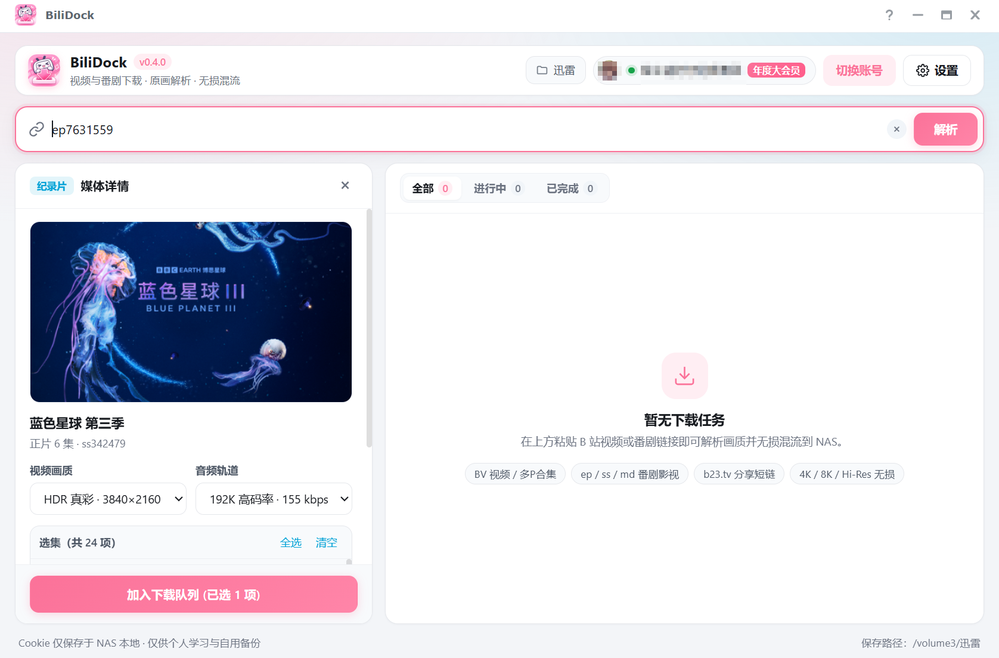

<div align="center">
  
  <h1>BiliDock</h1>
  <p>面向群晖 DSM 7 的轻量化 B 站视频与番剧下载套件<br>DSM 桌面窗口内嵌运行 · 扫码登录 · 编码选择 · 无损混流 MP4</p>
</div>

---

## 界面预览



## 核心特性

- **原生 DSM 桌面窗口集成**：基于 DSM `/webman/3rdparty/bilidock/index.cgi/` 同源代理，直接在 DSM 5000/5001 端口的桌面小窗口中运行，**无需额外开放端口，无需跳转新标签页**，完全复用 DSM HTTPS 证书与访问控制。
- **账号扫码登录**：支持手机 B 站客户端扫码登录，Cookie 仅保存于 NAS 本地 `var/config.json`（`0600` 权限），解锁高画质与大会员番剧权限。
- **全类型内容解析**：支持普通视频（BV / av）、多 P 合集、番剧 / 纪录片 / 电影（ep / ss / md）及 `b23.tv` 分享短链。
- **画质、编码与音轨自由组合**：
  - 视频画质：8K / 杜比视界 / HDR 真彩 / 4K / 1080P60 / 1080P 高码率 / 1080P / 720P / 480P（目标画质不可用时自动向下适配）
  - 视频编码：自动优先 / AVC (H.264) / HEVC (H.265) / AV1
  - 音频轨道：Hi-Res 无损 / 杜比全景声 / 192K / 132K / 64K
- **批量选集 & 无损混流**：多 P 与番剧支持勾选批量加入队列；后台支持多任务并发（1–10）与分片多线程下载（1–32），下载完成后调用内置静态 `ffmpeg` 执行 `-c copy` 无损封装为 `.mp4`。
- **防风控设计**：
  - 统一请求节流闸门与随机抖动，内置安全节流间隔
  - 自动获取并持久化 `buvid3` / `buvid4` / `_uuid` 设备指纹与 WBI 密钥缓存
  - 触发 HTTP 412/429 或 `-352/-412/-509/-799` 风控码时自动熔断冷却，避免连续重试加重限制
  - 支持自定义 User-Agent、下载限速（KB/s）与 HTTP 代理
- **存储安全与权限自检**：设置页自动筛选并仅列出套件有写入权限的共享文件夹，保存前真实写探针校验；非 root 独立用户运行。

## 架构说明

```text
DSM 桌面窗口 (Ext JS AppWindow + iframe)
  │
  ▼  /webman/3rdparty/bilidock/index.cgi/
BiliDock CGI 代理 (同二进制 -cgi 模式，显式禁用外部环境变量代理直连回环)
  │
  ▼  http://127.0.0.1:18088
BiliDock 常驻服务 (Go 单二进制 + 内嵌前端 + SSE 实时进度)
  ├── 登录与鉴权：passport 扫码、nav 缓存、WBI 签名、buvid 设备指纹
  ├── 内容解析：view / wbi/playurl / pgc/view/web/season / pgc/player/web/v2/playurl
  ├── 下载调度：动态并发任务队列 + Range 分片多线程 + 令牌桶限速 + 备用 CDN 轮换
  └── 媒体封装：静态 ffmpeg 无损 stream copy 输出 MP4
```

## 目录结构

```text
bilidock-spk/
├── assets/
│   └── icon-master.png          # 应用主图标 (1254×1254 圆角透明)
├── backend/                     # Go 服务源码与内嵌 Web 前端
│   ├── main.go                  # 启动入口与 CGI 模式分发
│   ├── config.go                # 配置持久化与共享文件夹权限探测
│   ├── client.go                # HTTP 客户端、节流、冷却、WBI 签名与图片代理
│   ├── bili.go                  # 扫码登录、普通视频解析、流筛选与短链展开
│   ├── pgc.go                   # 番剧 / 影视 / 纪录片解析与播放流获取
│   ├── download.go              # 动态并发调度、Range 分片下载与 FFmpeg 混流
│   ├── api.go                   # HTTP API、SSE 事件流与单页内联资源服务
│   ├── cgi.go                   # DSM CGI 反向代理
│   └── web/                     # 原生 HTML / CSS / JS 前端（零前端构建依赖）
├── docs/
│   └── screenshot.png           # 运行界面截图
├── package/                     # DSM SPK 模板与脚本
│   ├── INFO.template
│   ├── conf/
│   ├── scripts/
│   └── target/ui/
├── tools/
│   └── spk_builder.py           # 群晖 USTAR SPK 打包器
├── .github/workflows/
│   └── release.yml              # Tag 触发自动构建 x86_64 & armv8 SPK
└── build.py                     # 跨平台一键构建脚本
```

## 安装使用

### 方式一：通过套件源安装（推荐）

在 DSM「套件中心 → 设置 → 套件来源」添加已收录本套件的第三方源后，直接在套件中心搜索 **BiliDock** 安装即可。

### 方式二：手动安装

1. 前往 [Releases](https://github.com/onelxzy/bilidock-spk/releases) 下载对应 NAS 架构的 `.spk` 包（Intel/AMD 选 `x86_64`，ARM64 选 `armv8`）。
2. 打开 DSM「套件中心 → 手动安装」，上传 `.spk` 完成安装（若提示信任级别，请在「套件中心 → 设置 → 常规」中允许任何发行者）。
3. 安装完成后刷新 DSM 桌面（`F5` 或 `Ctrl + F5`），点击桌面上的 **BiliDock** 图标即可在窗口内打开。
4. 首次使用建议先在右上角「设置 → 存储位置」中选择一个已授读写权限的共享文件夹（或在 File Station / 控制面板中为 `bilidock` 用户授予目标共享文件夹读写权限）。

## 从源码构建

环境要求：Go 1.21+、Python 3.10+、Pillow。

```bash
pip install pillow
python3 build.py 1.0.0
```

构建脚本会自动交叉编译 `linux/amd64` 与 `linux/arm64` 后端、按需拉取静态 `ffmpeg` 并生成：

- `dist/BiliDock_1.0.0_x86_64.spk`
- `dist/BiliDock_1.0.0_armv8.spk`

## 免责声明

本项目基于公开网页接口实现，仅供个人学习、技术研究与个人合法购买/自用备份使用。音视频版权归原平台及权利人所有，请勿用于商业用途或公开传播。
